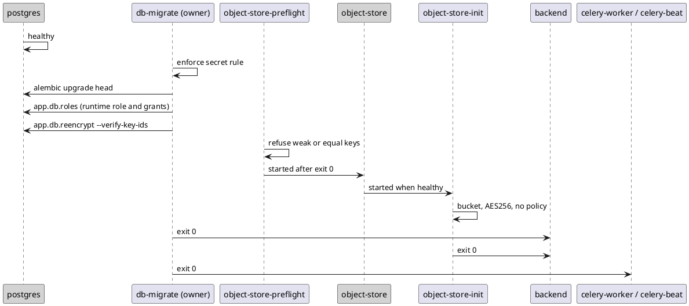

# 06 - Runtime View

Critical scenarios that illustrate item interactions, security enforcement, and error/exception behavior. Each links to a PlantUML diagram in `docs/specifications/`.

## 6.1 Login with lockout and session creation (SR-002, SR-029, SR-030)

Diagram: [`../specifications/diagram-seq-login.puml`](../specifications/diagram-seq-login.puml)

- Credentials verified with Argon2id; invalid attempts and non-existent usernames are treated identically (generic error) to prevent enumeration (SR-002.2, SR-029.6).
- 5 consecutive failures lock the account for 30 minutes; lockout is audited (SR-029).
- A failed attempt increments the lockout counter first and is audited afterwards, so a refused audit write cannot skip the count (SR-029).
- On success: Redis session created with role-based TTL, hardened cookie set, success audited with the originating client address (section 6.9; SR-030, SR-023 AC 6).
- **Session cap (SR-030 AC 7):** counting the account's live sessions, evicting the oldest above 3 and storing the new session are one optimistic Redis transaction (`WATCH`/`MULTI`/`EXEC`), so parallel logins cannot exceed the cap. Members whose `session:{id}` key has expired are dropped in the same transaction. The login response reports an evicted session (`evicted_session`) and the login page shows the notification. A refresh is a conditional write, so a session ended by logout, eviction or a password-change kill is never recreated.
- **Error/exception:** locked or invalid → 401 generic; expired absolute lifetime later forces re-auth (SR-030.3). If other logins for the same account keep committing and the cap cannot be applied within 20 attempts, no session is stored and the answer is `503` with `Retry-After: 1` (problem type `session-cap-contention`; section 12).

## 6.2 Doctor views a patient's clinical data (SR-005, SR-006, SR-036)

Diagram: [`../specifications/diagram-seq-doctor-access.puml`](../specifications/diagram-seq-doctor-access.puml)

- Every request resolves the session, then `AuthorizationService` evaluates the **union of active consent grants** for the (doctor, patient) pair (SR-036.3).
- No active grant → deny-by-default 403, access attempt audited, no data disclosed (SR-005.2/4, SR-023.2).
- Active grant (manual or any confirmed appointment) → entries returned, access audited with basis (SR-006.4).

## 6.3 Appointment creation, notification, confirmation → consent; decline scoping (SR-010, SR-035, SR-036)

Diagram: [`../specifications/diagram-seq-appointment-consent.puml`](../specifications/diagram-seq-appointment-consent.puml)

- Creation validates references/datetime, sets PENDING, enqueues dual-channel notification (SR-010, SR-035.1/2/3).
- **Only the patient** can confirm/decline (SR-035.9). Confirm creates an `APPOINTMENT:{id}` consent grant (SR-036.1); the doctor's effective access is the union of all grants.
- Decline deactivates **only** that appointment's grant (Cases A/B/C, SR-036.4): pre-existing manual or other-appointment grants are untouched.
- Every confirm/decline + grant change is audited (SR-035.10, SR-036.6).

## 6.4 Open and view DICOM via the plugin module (SR-015, SR-016, SR-017, SR-018, SR-026)

Diagram: [`../specifications/diagram-seq-dicom-view.puml`](../specifications/diagram-seq-dicom-view.puml)

- The shell shows the viewer nav item only if the module is enabled for one of the user's groups (SR-015.3, SR-016.2); the module loads as a lazy chunk (ADR-0005).
- The byte request passes `ModuleAccessGuard` (enablement) then `AuthorizationService` (consent) (SR-005, SR-015, SR-017.5); the module obtains bytes only through `AttachmentService` (SR-016.3).
- Cornerstone3D applies modality/VOI LUT, orders slices, sets default window/level, renders initial image within 10 s (SR-017.3/4, SR-026.3); user interacts via window/level, zoom, pan, slice nav (SR-018).
- **Error/exception:** not enabled or not authorized → 403, audited; WebGL-incapable browser is out of the supported set (SR-019).

## 6.5 Account creation, activation and lifecycle (SR-032, SR-033, SR-034)

Diagram: [`../specifications/diagram-activity-account-lifecycle.puml`](../specifications/diagram-activity-account-lifecycle.puml)

- Role-constrained creation (admin cannot create sysadmin), unique-email enforcement, INACTIVE state, audited (SR-032).
- Single-use 72 h activation link; user sets policy-compliant password twice; account becomes ACTIVE; audited (SR-033). The e-mailed link is `/activation/<token>`, the route of the SPA, which posts the token to `POST /api/v1/activation/{token}`. The API process puts the e-mail on the Celery broker (it binds the configured Celery app in its lifespan), the `celery-worker` service sends it, and `U-ID-Activation` resend is decided by `AuthorizationService` (`activation:resend`) like every other account action.
- The token is a path segment, so it is kept out of every log: the API's 500 record names the route template, the reverse proxy writes an allow-list access log with the activation paths replaced by `[redacted]` and logs only `crit` errors on the activation locations, and Celery's debug task headers are redacted (SR-043 AC 4; section 8.4).
- Every account action (create, deactivate, reactivate, delete, activation resend) is a decision of `U-AUTHZ-Policy` and is audited as allowed or denied (SR-032 AC 1, AC 4, AC 5; SR-034 AC 1). If the broker is unreachable the enqueue fails within about a second inside the request and the request fails; the appointment-notification and session-kill call sites log a WARNING with identifiers only (PRB-013 stays open).
- Lifecycle: deactivate (sessions killed ≤30 s, data retained), reactivate, or delete (confirm → anonymize with 5-year retention, email released); all audited (SR-034, SR-024). Deletion detail in 6.7.
- **Error/exception:** expired token → admin resend; password policy/mismatch → rule-specific error (SR-033.3/4).

## 6.6 Patient revokes manual consent (SR-008)

- Patient revokes a `MANUAL` grant via `DELETE /consents/{id}`; the row is deactivated transactionally; subsequent doctor requests are denied **immediately** because authorization reads live consent on each request (SR-008.4). Revoke requires confirmation (SR-027.2) and is audited (SR-008.5).

## 6.7 Account deletion → anonymized retention, and self-service retrieval (SR-024, SR-034, ADR-0013)

Decision: [ADR-0013](adr/0013-account-deletion-anonymized-retention.md). Flow shown in [`../specifications/diagram-activity-account-lifecycle.puml`](../specifications/diagram-activity-account-lifecycle.puml) (delete branch).

- **Delete:** after the SR-034.6 confirmation, `SI-IDENTITY` (`U-ID-Erasure`) severs credentials + PII from the record data and re-keys it into an **anonymized dataset**; the email is released for reuse (SR-034.7). A high-entropy **anonymization code** is generated, sent to the user by email, and **never stored** — only a salted KDF hash is persisted to locate-and-authorize later retrieval (ADR-0011). A 5-year retention deadline is set. The deletion is audited with the anonymized dataset id but never the code (SR-023, SR-024.3).
- **Retrieve (within 5 years):** the (now anonymous) user presents the code; the system derives the same salted hash, matches the anonymized dataset, authorizes retrieval, and audits it. A wrong/lost code cannot retrieve the data — there is no recovery path (by design, ADR-0013).
- **Expiry:** a scheduled `SI-WORKER` job permanently and irreversibly erases any anonymized dataset whose 5-year deadline has passed (SR-024.4).
- **Error/exception:** invalid/expired code → generic denial, audited; expired dataset → not found.

## 6.8 Start-up order and migration (SR-023 AC 8, SR-041 AC 3, SR-022 AC 7; ADR-0017, ADR-0018)

Compose file: `infra/docker-compose.yml`. Procedure: `infra/DEPLOY.md`.

- `db-migrate` is the only process that runs Alembic and the only one given `DATABASE_OWNER_URL`. In one run it checks the secret settings, migrates, creates or refreshes the runtime role and its grants, then refuses (changing nothing) if a stored field value names a key id that is not configured. A refusal keeps `backend`, `celery-worker` and `celery-beat` down, so the application cannot be used to repair data.
- `backend`, `celery-worker` and `celery-beat` connect as the runtime role and run the secret rule themselves on start (the API in its lifespan, Celery on `worker_init`/`beat_init`). A missing or placeholder secret stops the process with a message naming the setting.
- The image entrypoint only runs `exec "$@"`: gunicorn is the image default, and `celery-worker` and `celery-beat` give their own `command:`. Exactly one `celery-beat` runs the retention schedule.
- Error/exception: a rejected object-store key keeps the store, the initialiser and the backend down; a volume written under another SSE key makes the initialiser exit 1 before the backend starts.

## 6.9 Client address through the proxy (SR-042, SR-023 AC 6; ADR-0019)

- The reverse proxy sets `X-Forwarded-For` and sits at a fixed address on the fixed `medhub` subnet. `U-API-ClientAddress` is the first middleware: the address of a request is the TCP peer unless the peer is in `TRUSTED_PROXIES`; then it is the right-most `X-Forwarded-For` entry that is not a trusted proxy. A forged header from any other peer is ignored; malformed entries are skipped.
- The address is published once per request. `AuditService.record` reads it when the caller passes none (no address outside a request, for example in a Celery task), and the retrieval rate limit uses it as its key.
- Error/exception: a wrong `TRUSTED_PROXIES` fails silently, so every address becomes the proxy's; `TS-016` checks on the started stack that an audit row's address is not the proxy's.

## 6.10 Field-encryption key rotation (SR-022 AC 6 to AC 8; ADR-0018)

- Every field value is stored as `mh1:<key-id>:...`. The operator makes the new key current, moves the old one to `AT_REST_ENCRYPTION_RETIRED_KEYS`, restarts the application services, then runs `python -m app.db.reencrypt --check` and `--apply` from the `db-migrate` image as the owner, and drops the old key only when `--check` shows no value under it.
- `--apply` refuses before writing if any value is unreadable. Otherwise it converts in batches; each batch is one transaction that takes a table lock against writers (readers continue), re-encrypts, decrypts the new value and compares it, reads the row back from the database and commits. A mismatch or error rolls that batch back and stops. Earlier batches stay committed and every row stays readable under the current or a retired key; running the command again continues. A run that cannot get the table lock within 10 seconds stops. For the first batch nothing has changed; after it, the earlier batches stay committed and the instruction is the same: run it again.
- The application stays up. A retired key cannot be removed while a value needs it, because `db-migrate` runs `--verify-key-ids` on every start.

## 6.11 Moving attachments to a new object-store SSE key (SR-041 AC 5; ADR-0018)

- The store cannot tell which key an object was written under: the key belongs to the volume. Changing `OBJECT_STORE_SSE_KEY` in place makes stored attachments unreadable, so the key is changed only by a copy: stop the stack and back up read-only, restore the backup into a copy, start a new store on a new volume under the new key with uploads blocked, start the source store on the copy, copy through the S3 API with checksum comparison (`backend/scripts/migrate_object_store.py`), verify, then retire the source and open the stack (`OBJECT_STORE_VOLUME` names the new volume). The source is read only throughout.
- Error/exception: a mismatch stops the copy; the rollback paths are in `infra/DEPLOY.md`, "Separating the object-store SSE key".
