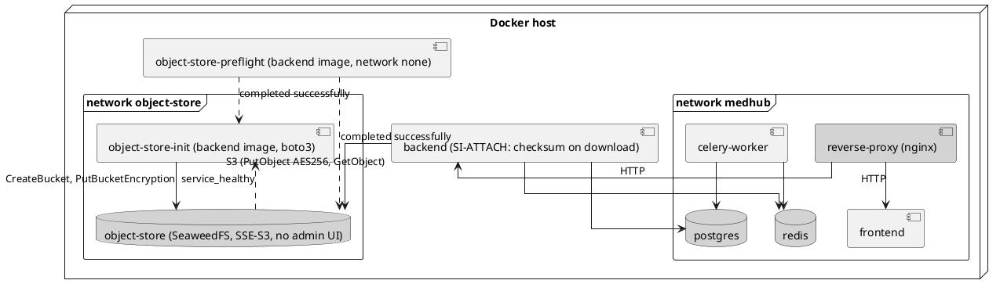

# ADR-0015: Object store component after the end of MinIO community edition

## Status

Accepted (2026-10-30, CR-002 Plan gate: the human chose option (b), SeaweedFS, for Q-1).
Proposed earlier the same day at the CR-002 Plan stage. It amends [ADR-0009](0009-file-object-storage.md). ADR-0009's
decision for S3-compatible storage with server-side encryption still stands. Only the choice of
MinIO as the self-hosted product changes.

## Context

[ADR-0009](0009-file-object-storage.md) chose MinIO as the self-hosted S3-compatible store.
The first SOUP anomaly review (CR-001 TASK-154, 2026-10-22,
[SOUP-022](../../soup/SOUP-022-minio.md)) found three things.

- The community edition has been source-only since 2025-10-15, unmaintained since 2026-02-12 and
  archived since April 2026. The repository page reads "archived by the owner on Apr 25, 2026"
  (checked 2026-10-30).
- No registry serves the pinned image, so a fresh or amd64 host cannot build the stack
  ([PRB-042](../../problem-reports/PRB-042-minio-community-edition-unmaintained.md)).
- Four hazard-relevant CVEs have no community fix, and MedHub's configuration exposes them
  ([PRB-043](../../problem-reports/PRB-043-minio-unfixed-cves-exposed-by-configuration.md),
  [RISK-012](../../risks/RISK-012-object-store-compromised-or-unpatchable.md)).

The client `mc` ([SOUP-023](../../soup/SOUP-023-minio-client.md)) is in the same state. Its
repository was archived on 2026-07-14.

CR-002 Q-1 asks for one of three options: replace the component, build an interim image from the
archived binaries, or do both.

**What MedHub needs from the component.** These are the selection criteria, taken from CR-002
AC-4, AC-7, AC-8 and AC-9, SR-022, SR-028 AC-7 and PLAN-002.

1. **S3 API used by `ObjectStorageClient` (boto3 1.43.117):**
   - `PutObject` with `ServerSideEncryption=AES256`;
   - `GetObject` and `DeleteObject`;
   - bucket creation;
   - `PutBucketEncryption` and `GetBucketEncryption` with SSE-S3 (`AES256`), so that a plain
     write is encrypted (AC-4);
   - `HeadObject` reports `ServerSideEncryption: AES256` (AC-7).
2. **Obtainable.** A multi-arch image (amd64 and arm64) that can be pulled anonymously from a
   public registry and pinned by its index digest (SR-028 AC-5, AC-7).
3. **Maintained.** Security fixes are published as new versions, so RISK-010's path 2 regains a
   fix path. The project is active and not archived.
4. **Licence.** Open source, or a licence the human accepts (CR-002 Boundaries).
5. **Single node fits.** It runs as a single node in Compose with one volume, and the
   administrative surface can be switched off (AC-1).
6. **Migration.** Existing objects and their key material can be migrated (AC-11). Q-5: no
   `minio_data` volume holds real data, so only development data is affected, but the
   procedure is rehearsed anyway.

## Options

All facts were checked on 2026-10-30. Sources are listed at the end.

| | (a) AIStor Free | (b) SeaweedFS 4.51 | (c) Interim: archived MinIO binaries | (d) Interim now, replacement later |
|---|---|---|---|---|
| Licence | Proprietary "MinIO Software License". A licence file is required to run. Redistribution is prohibited. The tier is single node. Support is self-service only | Apache-2.0 | AGPLv3, unchanged | as (c), then as (a) or (b) |
| Maintained (criterion 3) | Yes. AIStor is where MinIO ships security fixes (every 2026 MinIO advisory names AIStor as the fixed version) | Yes. Releases 4.49, 4.50 and 4.51 came out on 2026-10-23, 2026-10-25 and 2026-10-25. The last push was 2026-10-30. 25 GitHub advisories in 2026, 9 of them critical, each fixed in a release; the newest affected version is ≤ 4.45 | **No.** No fix will ever ship. The four PRB-043 CVEs stay | No until the second step |
| Image (criterion 2) | `quay.io/minio/aistor/minio`. The quay API answers anonymously. The tags include `edge-daily`, as a 2-platform manifest list | `chrislusf/seaweedfs:4.51`, an index digest with amd64, arm64, arm/v7, 386, ppc64le and s390x. Updated 2026-10-26. cosign-signed since 4.46, with SBOM and provenance attestations since 4.50 | No image. A local `Dockerfile` downloads `minio` and `mc` from the archived GitHub release (`.sha256sum`, `.asc` and `.minisig` assets exist for linux-amd64 and arm64, listed 2026-10-30) on a pinned base image. The binaries can disappear without notice | as (c) |
| SSE-S3 and bucket default (criterion 1) | Yes (MinIO feature set) | Yes. `x-amz-server-side-encryption: AES256` and bucket default encryption through the standard bucket encryption API (`weed/s3api/s3_bucket_encryption.go`). The key comes from `WEED_S3_SSE_KEY` (HKDF-SHA256) or `WEED_S3_SSE_KEK`. **`HeadObject` reporting `AES256` is not documented. The TASK-172 spike confirms it** | Yes (unchanged) | Yes |
| Console or admin surface (criterion 5) | Built-in console, switched off with flags | Admin UI, WebDAV, SFTP, Iceberg and Lance listeners. Each has a flag to switch it off. Master, volume and filer have unauthenticated internal HTTP and gRPC ports unless JWT is configured | Console, switched off with flags | — |
| Migration (criterion 6, AC-11) | Probably in place on the same volume (same vendor). Not confirmed: a rehearsal is needed | Copy through the S3 API: read from MinIO (which decrypts), write to SeaweedFS (bucket default SSE, new key), compare with the stored `checksum` | None | Twice |
| RISK-010 path 2 (AC-14) | Fix path again → expected 3 × 1 | Fix path again → expected 3 × 1 | Stays 3 × 2 (`alarp`): the review still cannot lead to a fix | 3 × 2 until the second step |
| RISK-012 | The CVEs are fixed. Expected 4 × 1 with the hardening and the checksum | The CVEs are gone (different code). A new, larger attack surface needs monitoring. Expected 4 × 1 with the hardening and the checksum | The CVEs stay. The hardening and the checksum reduce reach and detect substitution. 4 × 1 is plausible, but the claim rests on configuration alone | as (c), then as (a) or (b) |
| AC-9 (fresh host, amd64) | Yes, if the licence file is present on the host | Yes | Yes, as long as GitHub keeps the archived assets | Yes |
| AC-10 (verified binaries) | Met: the ADR states that no image is built from binaries | Met: the ADR states that no image is built from binaries | Required: checksum and signature verification in the build, plus a tampered-binary negative test | Required in step 1 |
| AC-11 (migration) | Required (rehearsal) | Required (rehearsal) | Met by stating that no migration is needed | Required in step 2 |
| PRB-042 intent (maintenance) | Met | Met | Not met: reproducibility is restored, maintenance is not | Met late |
| Human decision needed | **Accept a proprietary licence** (Boundaries), and register for a licence key for every deployment | No licence decision | Accept that the component stays unpatchable | Both, twice |
| Effort (CR-002 tasks) | Like (b), plus licence-file handling in Compose and DEPLOY.md | 11 tasks (CR-002 plan) | About 9 tasks. No migration, but a binary-verification build with a negative test | (c) now, and a second CR later |

### Rejected without full comparison

- **Garage** (AGPL-3.0, active, last push 2026-10-24). It supports SSE-C only. Its compatibility
  page lists `PutBucketEncryption`, `GetBucketEncryption` and `DeleteBucketEncryption` as
  "Missing". It fails criterion 1 (AC-4).
- **Versity S3 Gateway** (Apache-2.0, v1.10.0 of 2026-10-22). It supports SSE-C only
  (`s3api/utils/ssec.go`), and `PutBucketEncryption` is in its `NotImplemented_actions`
  integration tests. It fails criterion 1.
- **Ceph RGW.** It supports SSE-S3 and the bucket encryption API, but only with HashiCorp Vault
  as the key backend (Reef and Tentacle docs). That means a Ceph cluster (mon, osd, rgw) plus
  Vault: two more SOUP items and several daemons for a single-node Compose deployment. That is
  disproportionate (criterion 5).
- **Zenko CloudServer** (Apache-2.0, repository active). Its Docker Hub images were last updated
  in 2023 and are amd64 only, and the GitHub release list is empty. It fails criterion 2 as far
  as this research could establish. Not pursued.

## Decision (recommended, pending the human's confirmation of Q-1)

**D1: replace MinIO with SeaweedFS (option b), pinned as
`chrislusf/seaweedfs:4.51@sha256:f7a49e3f3972ebed5be2ed4befa4a0c68eb7bdddba6e692d42729ceb545134b8`**
(Docker Hub index digest, 2026-10-26). TASK-172 re-resolves the digest.

- It is the only evaluated option that meets all six criteria without a proprietary licence.
- It restores a fix path, which is the intent of PRB-042 and the condition for 3 × 1 on
  RISK-010 path 2.
- It is a direct replacement, not an interim step. No release is made before CR-002 (CR-002
  D-1), and no volume holds real data (Q-5), so a temporary rebuild of MinIO would be thrown
  away. Option (d) costs two migrations for no benefit.

How it is deployed:

- One `object-store` service runs the SeaweedFS all-in-one server (master, volume, filer and S3)
  on one named volume.
- Off: admin UI, WebDAV, SFTP, Iceberg, Lance and metrics listeners. TASK-172 lists the exact
  flags and every port that still listens.
- S3 credentials come from `OBJECT_STORE_ACCESS_KEY` and `OBJECT_STORE_SECRET_KEY` as the admin
  identity.
- The SSE-S3 key is derived from `AT_REST_ENCRYPTION_KEY` through `WEED_S3_SSE_KEY`. The source
  stays the variable that MinIO's `MINIO_KMS_SECRET_KEY` used, so Q-3 holds: the handling of
  that variable stays with PRB-007.

**D2: the bucket initialiser becomes a Python module in the backend image, using boto3, and `mc`
is retired** (SOUP-023 → `obsolete`). This applies under every option.

- It creates the bucket and sets SSE-S3 default encryption with `PutBucketEncryption`.
- It reads the configuration back with `GetBucketEncryption` and exits non-zero on any error
  (PRB-039).
- No anonymous policy needs setting: S3 buckets are private by default, and the initialiser
  checks that no bucket policy exists.
- boto3 is already SOUP-019, so the change removes a SOUP item instead of adding one. The
  credential rule (Q-2) is implemented once, in Python, and is unit-testable.

**D3: credential preflight.** A one-shot `object-store-preflight` service runs the Q-2 rule from
the backend image with `network_mode: none`. The `object-store` and `object-store-init` services
start only after it has completed successfully. The rule rejects an access key or secret key that
is unset, empty or a known default (`minioadmin`, `changeme`, `admin`, `password`, `secret`), and
a secret key shorter than 16 characters. Each rejection names the setting. Compose `${VAR:?}`
guards cover the unset case before any container starts.

**D4: network.** A dedicated `object-store` network, joined only by `object-store`,
`object-store-init` and `backend`. `backend` also stays on `medhub`. The store publishes no host
port.

### Spike result (TASK-172)

**2026-10-30: go.** The digest in D1 was re-resolved and is unchanged. 4.51 is the newest
release. The published image was used as is: no image is built from downloaded binaries
(CR-002 AC-10). Against it, with boto3 1.43.117, every contract item passed: SSE-S3 upload
(`AES256`), `HeadObject` reporting `AES256`, bucket default encryption through
`PutBucketEncryption` and `GetBucketEncryption`, an unencrypted `PutObject` stored encrypted,
identical bytes on `GetObject`, `NoSuchBucketPolicy`, 403 for a wrong secret, boto3 default
checksums accepted, and restart with the objects still decrypting. A plaintext marker was not
found in the data directory (a control without SSE did find it). The `HeadObject` question
left open in the options table is answered: it reports `AES256`.

One change to D1's deployment came out of the run. The all-in-one `weed mini` command exposes
the filer, master and volume server without authentication on every interface, and a `PUT` to
the filer planted an unencrypted object that S3 then served. D1 therefore uses
`weed server` with `-ip.bind=127.0.0.1 -s3.ip.bind=0.0.0.0`, which leaves only S3 (8333, and its
gRPC port 18333) off loopback. The command line, the listener list and the health check are in
[SOUP-036](../../soup/SOUP-036-seaweedfs.md) and TASK-172. Licence: Apache-2.0, read from the
repository.

## Consequences

### Positive

- PRB-042 is resolved in its intent: a maintained component, pinned by digest and obtainable
  from a public registry on amd64 and arm64.
- The four PRB-043 CVEs leave the deployment with the MinIO code.
- No proprietary licence and no licence-key logistics per deployment.
- One SOUP item fewer (`mc`), and the initialiser is tested like the rest of the backend.
- cosign signatures and provenance attestations make a later signature check possible (not
  required by AC-10, because no image is built from binaries).

### Negative

- **Large attack surface, high advisory rate.** 25 advisories in 2026, 9 critical, several in
  components MedHub does not use (SFTP, Lance, remote storage, filer stores). Each was fixed in a
  release. MedHub must disable the unused listeners and keep up with releases.
  - PLAN-002 monitoring for this item needs a shorter cadence than "at every dependency change and
    yearly": a monthly advisory check (TASK-172 proposes the PLAN-002 amendment; the human approves).
  - SeaweedFS publishes no end-of-life policy. Fixes ship only in the latest release (rolling).
    PLAN-002's end-of-support rule therefore reads as "the pinned release must be no more than one
    review interval behind a release that fixes a hazard-relevant advisory". That is recorded in
    SOUP-036.
- **Internal ports of the all-in-one server.** Master, volume and filer listen with HTTP and gRPC
  on the `object-store` network, and they are unauthenticated unless JWT signing is configured.
  D4 limits reach to the backend and the initialiser, which already hold the S3 credentials. The
  spike records every listener and binds what it can to loopback.
- **SSE semantics are SeaweedFS's own implementation.** AC-4 and AC-7 verify the behaviour MedHub
  relies on against the real server, in CI on every pull request.
- **A migration is needed** (TASK-178), and the MinIO SSE key material is retired after it.
- **Key reuse carries over.** `AT_REST_ENCRYPTION_KEY` feeds both field encryption (SI-PERSIST)
  and the object-store SSE key, as it did with MinIO. Q-3 keeps that with PRB-007. See the open
  question in CR-002.

### Neutral

- ADR-0009 still holds: S3-compatible API, backend-mediated access, SSE. Its "MinIO" wording is
  amended by this ADR, and its README row gains a note.
- `ObjectStorageClient` does not change, apart from the `OBJECT_STORE_ENDPOINT` value.

### If the human chooses another option

| Option | Tasks that change (CR-002 plan) |
|---|---|
| (a) AIStor Free | TASK-172 spikes AIStor (licence file mount, `quay.io/minio/aistor/minio` digest, SSE-S3, in-place volume upgrade) and creates SOUP-036 "MinIO AIStor". The human first accepts the licence. TASK-176 swaps the image and adds the licence file as a host-mounted secret (never in git) and DEPLOY.md steps. TASK-178 rehearses an in-place upgrade instead of a copy. D2, D3 and D4 and every other task stay |
| (c) Interim | TASK-172 becomes the binary-verification design (minisign public key source, base image). TASK-176 becomes "Build the MinIO server image from the archived release binary with SHA-256 and minisign verification, plus a tampered-binary negative test" (AC-10). TASK-178 is dropped (AC-11 met by this ADR). SOUP-022 is updated (packaging), not made obsolete. TASK-181 keeps RISK-010 path 2 at 3 × 2. D2 still retires `mc` |
| (d) Interim, then replacement | As (c) in CR-002. A new CR repeats (a) or (b) with TASK-172, 176 and 178 |

## Alternatives Considered

See "Options" and "Rejected without full comparison" above.

## References

- CR-002 (Q-1..Q-5, AC-1..AC-20), PRB-036, PRB-039, PRB-042, PRB-043, RISK-010, RISK-012,
  SOUP-022, SOUP-023, SR-013, SR-022, SR-028, SR-040, PLAN-002.
- Related: ADR-0009, ADR-0010, ADR-0011.

Sources, all checked on 2026-10-30:

- MinIO repository archived (README commit `7aac2a2c5b`): https://github.com/minio/minio ;
  release `RELEASE.2025-09-07T16-13-09Z` assets via the GitHub API
  `repos/minio/minio/releases/tags/…`. The `mc` repository was archived on 2026-07-14:
  https://github.com/minio/mc/releases/tag/RELEASE.2025-08-13T08-35-41Z
- AIStor container install (licence file, `quay.io/minio/aistor/minio`):
  https://docs.min.io/aistor/installation/container/install/ ; pricing and FAQ (single node,
  "Redistribution is prohibited", self-service support): https://www.min.io/pricing ; quay API
  `https://quay.io/api/v1/repository/minio/aistor/minio` (HTTP 200, anonymous)
- SeaweedFS SSE: https://github.com/seaweedfs/seaweedfs/wiki/Server-Side-Encryption (edited
  2026-04-06) ; source `weed/s3api/s3_bucket_encryption.go`, `weed/s3api/s3_sse_s3.go` ;
  `weed/command/mini.go` (listener flags) ; releases https://github.com/seaweedfs/seaweedfs/releases ;
  advisories `repos/seaweedfs/seaweedfs/security-advisories` (GitHub API) ; image
  https://hub.docker.com/v2/repositories/chrislusf/seaweedfs/tags/4.51
- Garage S3 compatibility:
  https://garagehq.deuxfleurs.fr/documentation/reference-manual/s3-compatibility/
- Versity S3 Gateway: https://github.com/versity/versitygw (code search: `s3api/utils/ssec.go`,
  `tests/integration/NotImplemented_actions.go`)
- Ceph RGW encryption: https://docs.ceph.com/en/reef/radosgw/encryption/ ,
  https://docs.ceph.com/en/quincy/radosgw/encryption/
- Zenko CloudServer: https://github.com/scality/cloudserver ;
  https://hub.docker.com/v2/repositories/zenko/cloudserver/tags
