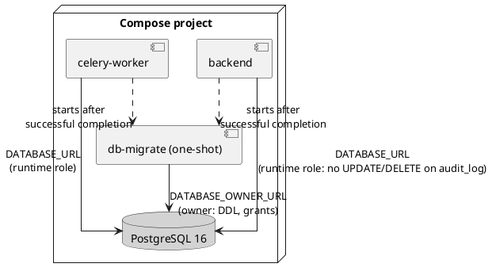

# ADR-0017: Separate database roles for migration and runtime; the audit log is append-only by privilege

## Status

Accepted (2026-10-31, CR-004 plan gate: the human approved the plan). Proposed earlier the
same day by the Software Architect role. It refines
[ADR-0011](0011-security-compliance-approach.md) (append-only audit log) and amends
[ADR-0010](0010-deployment-model.md) (one more one-shot service in the Compose topology). It
becomes Accepted with the human's approval of the CR-004 plan.

## Context

SR-023 AC 8 (1.4) requires that the database role the application connects with cannot update or
delete audit rows, and that such a statement **fails with a permission error**.

Today (PRB-005 Investigation):

- the backend, the worker and the migrations all connect as `medhub`, which is `POSTGRES_USER` of
  the official PostgreSQL image and therefore a superuser that owns every table
  (`infra/docker-compose.yml:90-92`, `infra/.env.example:14`, `backend/entrypoint.sh:4`);
- migration 0006 adds `DO INSTEAD NOTHING` rules on `audit_log`. They turn tampering into a silent
  success, and the owner can drop them;
- privileges do not apply to a superuser, so a `REVOKE` alone changes nothing.

CR-004 A-3 is confirmed: no application code path updates or deletes `audit_log` rows. Only three
test clean-ups delete them.

## Options

1. **Trigger that raises `insufficient_privilege` (SQLSTATE 42501) on `UPDATE`/`DELETE`.** Meets
   the letter of AC 8 with one migration. The application still runs as a superuser that owns the
   table and can drop the trigger, and every other table stays writable by a superuser
   credential (PRB-007 item 3).
2. **Two roles: an owner role for migrations, a non-owner runtime role for the application.** The
   runtime role gets `SELECT, INSERT` on `audit_log` and no `UPDATE`, `DELETE` or `TRUNCATE`;
   PostgreSQL itself refuses the statement with 42501. The runtime role cannot alter or drop
   anything.
3. **A separate audit database or an external append-only sink.** Strongest separation; a new
   component, a second connection in every request, and a larger change than the requirement
   needs.

## Decision

Option 2.

- **Roles.** The owner role stays `POSTGRES_USER` (`medhub`). The runtime role (default name
  `medhub_app`) is `LOGIN NOSUPERUSER NOCREATEDB NOCREATEROLE NOINHERIT`, owns nothing, and is the
  user in `DATABASE_URL`. The owner connection is a new secret setting, `DATABASE_OWNER_URL`,
  given only to the migration service.
- **One place for privileges.** A module `app.db.roles` runs after `alembic upgrade head`, as the
  owner, on every start. It creates the runtime role if it is missing, sets its password from
  `DATABASE_URL`, grants `SELECT, INSERT, UPDATE, DELETE` on every application table and `USAGE`
  on every sequence, then revokes `UPDATE, DELETE, TRUNCATE` on `audit_log` from the runtime role.
  It is idempotent, so a table added by a later migration gets its grants on the next start. No
  migration names the runtime role.
- **Migration 0009** drops the two rules of 0006, so a refused statement is loud and the owner can
  still administer the table.
- **Start-up order.** A one-shot Compose service `db-migrate` (backend image) runs the migrations
  and `app.db.roles` with `DATABASE_OWNER_URL`. `backend` and `celery-worker` depend on it with
  `service_completed_successfully`, use `DATABASE_URL` (runtime role) and no longer migrate.
  `backend/entrypoint.sh` loses its `alembic upgrade head`.
- **Existing databases.** The same `db-migrate` run converts an existing installation: it creates
  the role and applies the grants. It is a grant change on an existing database, so CR-004's
  boundary applies: it is rehearsed on a copy of a populated database before it runs anywhere
  else, and the human approves that run.

## Consequences

### Positive

- AC 8 holds by PostgreSQL's privilege system, not by code convention, and fails loudly.
- A leaked application credential is no longer a superuser credential (PRB-007 item 3, RISK-001).
- Migrations run once per start instead of in every backend replica.

### Negative

- One more secret setting (`DATABASE_OWNER_URL`) and one more one-shot service. SR-041 covers the
  secret: no default, refused when it holds a placeholder.
- A table whose grants are missing makes the application fail with a permission error until the
  next `db-migrate` run (RISK-007, availability). Mitigated by running `app.db.roles` after every
  migration and by a real-database test that runs the application's statements as the runtime
  role.
- Tests that clean up `audit_log` must use the owner connection. Real-database tests that
  exercise AC 8 must connect as the runtime role, which the test fixture creates the same way.

### Neutral

- The independent audit transaction of ADR-0016 uses the same engine and therefore the runtime
  role; it only inserts.

## Alternatives considered

Options 1 and 3 above. Option 1 was rejected because it leaves the application as a superuser,
which RR-003 and SR-041's rationale argue against, for almost the same amount of change. Option 3
was rejected as more than the requirement needs at MVP scale (ADR-0001).

## References

- Requirements: SR-023 AC 5, AC 8; SR-041 AC 2, AC 3; RR-004; NFR-007
- Problem reports: PRB-005, PRB-007
- Risks: RISK-006, RISK-007, RISK-001
- Related: ADR-0004, ADR-0010, ADR-0011, ADR-0016; ADD-016, ADD-026
